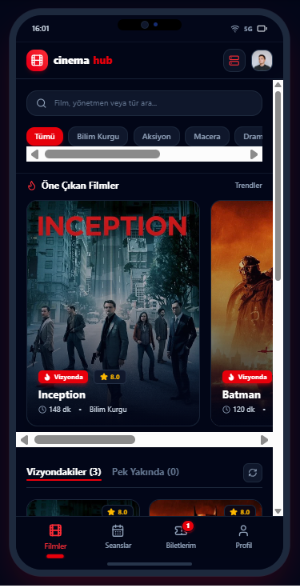
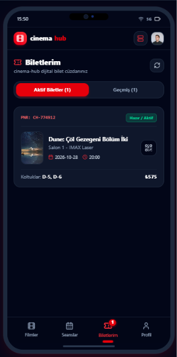
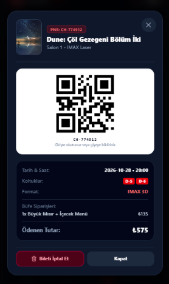
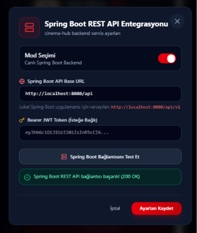

# 🎬 CinemaHub

**A full-stack cinema ticket booking and reservation platform.**


CinemaHub lets users browse now-showing and upcoming movies, pick showtimes, choose seats on an interactive seat map, add snacks to their order, and receive a digital QR ticket. The backend is a layered Spring Boot REST API secured with stateless JWT authentication and role-based access control.

---

## 📸 Screenshots

| Movie Catalog | My Tickets | Digital QR Ticket | Backend Integration |
|:---:|:---:|:---:|:---:|
|  |  |  |  |

---

## ✨ Features

### 📱 Frontend (React 19, TypeScript, Tailwind CSS v4)

- **Mobile-first, cinematic UI:** dark theme, glassmorphism and smooth micro-animations.
- **Movie catalog:** genre filtering (Sci-Fi, Drama, Action, etc.), instant search, and separate lists for now-showing and upcoming movies.
- **Movie details:** poster, synopsis, director, cast, duration, age rating and showtime selection.
- **Interactive seat selection:** cinema screen simulation, standard and VIP seat categories, and clear color states for available, selected and booked seats.
- **Snack bar:** add popcorn, drinks and snacks while booking a ticket.
- **Digital ticket wallet:** QR-coded ticket cards with PNR code, hall and showtime details, plus instant ticket cancellation.
- **Authentication and profile:** JWT-based login, registration and profile management.

### 🛡️ Backend (Spring Boot 3, Java 21)

- **Layered architecture:** clear separation of Controller, Service, Repository, DTO and Entity layers.
- **Spring Security and JWT:** stateless authentication, BCrypt password hashing and role-based authorization (`ROLE_USER`, `ROLE_ADMIN`).
- **Business rules:** prevents double-booking of the same seat for the same showtime (`SeatAlreadyBookedException`).
- **Database seeding (`DataInitializer`):** on first startup, sample users, halls, seats and movies with posters are loaded automatically.
- **Swagger / OpenAPI:** interactive API documentation at `/swagger-ui/index.html`.
- **Global exception handling:** consistent error responses via a `GlobalExceptionHandler`.

---

## 🏛️ Project Structure

```
cinemahub/
├── backend/                       # Spring Boot 3 + Java 21 REST API
│   ├── src/main/java/com/eda/cinemahub/
│   │   ├── config/                # Security, CORS, OpenAPI & DataInitializer
│   │   ├── controller/            # Auth, Movie, ShowTime, Seat, Hall, Ticket APIs
│   │   ├── dto/                   # Request & response DTOs
│   │   ├── entity/                # JPA entities (User, Movie, Hall, Seat, ShowTime, Ticket)
│   │   ├── exception/             # GlobalExceptionHandler & custom exceptions
│   │   ├── repository/            # Spring Data JPA repositories
│   │   ├── security/              # JWT filter and token service
│   │   └── service/               # Business logic layer
│   └── src/main/resources/
│       └── application.properties # Database and JWT configuration
│
└── frontend/                      # React 19 + TypeScript + Vite client
    ├── src/
    │   ├── components/            # UI components (Auth, Booking, Movies, Tickets, Common)
    │   ├── services/              # Backend API client (apiClient, auth, movie, booking)
    │   ├── types/                 # TypeScript types
    │   └── App.tsx                # Main app and screen routing
    └── package.json
```

---

## 🚀 Getting Started

### Prerequisites

- **Java 21** or higher
- **Node.js** v18+ and **npm**
- **MySQL** server (local installation or Docker)

### 1. Backend

1. Set your database password as an environment variable. `application.properties` reads it as `DB_PASSWORD`:

   **Windows (PowerShell)**
   ```powershell
   $env:DB_PASSWORD="your_mysql_password"
   ```

   **macOS / Linux**
   ```bash
   export DB_PASSWORD=your_mysql_password
   ```

   If your MySQL username or URL differs from the defaults, adjust them in `backend/src/main/resources/application.properties`:
   ```properties
   spring.datasource.url=jdbc:mysql://localhost:3306/cinemahub?createDatabaseIfNotExist=true
   spring.datasource.username=root
   spring.datasource.password=${DB_PASSWORD:changeme}
   ```

2. Start the backend from the same terminal session:
   ```bash
   cd backend
   ./mvnw spring-boot:run
   ```

3. The API will be available at `http://localhost:8080`. The database is created automatically if it does not exist.

4. Open the Swagger UI to explore and test the API:
   `http://localhost:8080/swagger-ui/index.html`

> **Demo accounts (seeded automatically, for development only; change them before any real deployment):**
> | Role | Username | Password |
> |---|---|---|
> | Admin | `admin` | `admin123` |
> | User | `eda` | `123456` |

### 2. Frontend

1. Go to the frontend directory:
   ```bash
   cd frontend
   ```
2. Install dependencies:
   ```bash
   npm install
   ```
3. Start the development server:
   ```bash
   npm run dev
   ```
4. Open the app in your browser: `http://localhost:3000`

The frontend connects to the backend through the **Spring Boot REST API Integration** settings dialog (server icon in the top bar), where you can set the API base URL (default `http://localhost:8080/api`) and test the connection.

---

## 📡 API Overview

| Method | Endpoint | Description | Access |
|---|---|---|---|
| `POST` | `/api/auth/register` | Register a new user | Public |
| `POST` | `/api/auth/login` | Log in and receive a JWT | Public |
| `GET` | `/api/auth/me` | Current user's profile | User / Admin |
| `GET` | `/api/movies` | List movies (search and genre filters) | Public |
| `GET` | `/api/movies/{id}` | Get movie details | Public |
| `GET` | `/api/showtimes` | List showtimes (`?movieId=` filter) | Public |
| `GET` | `/api/seats` | List seats (`?hallId=` filter) | Public |
| `GET` | `/api/tickets/occupied-seats/{showTimeId}` | Booked seat IDs for a showtime | Public |
| `POST` | `/api/tickets` | Purchase a ticket | Authenticated |
| `GET` | `/api/tickets/my-tickets` | List the current user's tickets | Authenticated |
| `DELETE` | `/api/tickets/{id}` | Cancel a ticket | Authenticated |

Authenticated endpoints expect the header `Authorization: Bearer <token>`.

---

## 🧱 Tech Stack

| Layer | Technologies |
|---|---|
| Backend | Java 21, Spring Boot 3, Spring Security, Spring Data JPA, JWT, Swagger / OpenAPI |
| Database | MySQL 8 |
| Frontend | React 19, TypeScript, Vite, Tailwind CSS v4 |

---

## 📝 Project Background

The frontend UI was prototyped with **Google AI Studio**. I designed and implemented the Spring Boot backend, the database model and the REST API, and integrated the frontend with it end to end (authentication, seat booking flow, tickets and cancellations).

---

## 👩‍💻 Author

**Eda Akkuş**
GitHub: [@edaakkus](https://github.com/edaakkus)
